# Skyjo Online

A free, phone-first multiplayer card game based on Skyjo's mechanics. Open a link, pick a name, and play with 2–8 friends in real time, or join a public room. No accounts. Available in English, Spanish (Latin America), and Portuguese (Brazil).

**Play now: https://skyjo-online.jcarl-30.workers.dev** · [What's new](CHANGELOG.md) · [Releases](https://github.com/jack1590/skyjo-online/releases)

<p align="center">
  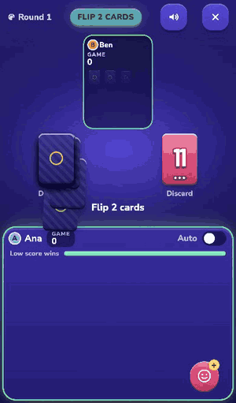
</p>

|                                                                                             Start or join a room                                                                                             |                                                                                                                Invite friends                                                                                                                |                                                                                                                                    Your turn, 9 seconds left                                                                                                                                    |
| :----------------------------------------------------------------------------------------------------------------------------------------------------------------------------------------------------------: | :------------------------------------------------------------------------------------------------------------------------------------------------------------------------------------------------------------------------------------------: | :---------------------------------------------------------------------------------------------------------------------------------------------------------------------------------------------------------------------------------------------------------------------------------------------: |
|  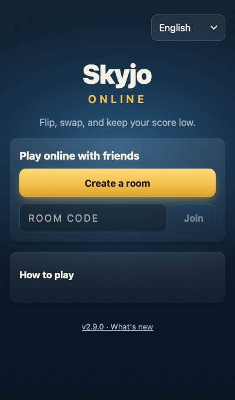  | 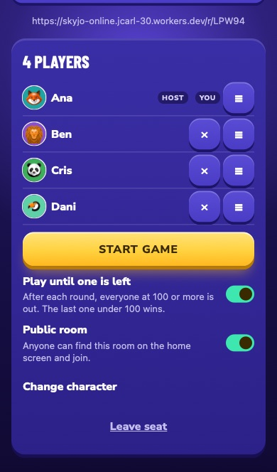 | 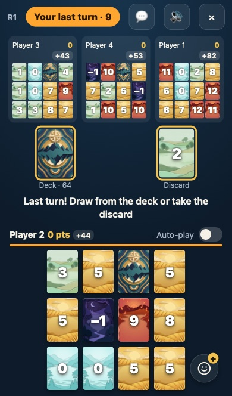 |
|                                                                                       **8 players, one on Auto-play**                                                                                        |                                                                                             **Tap an opponent: see their cards, throw a donkey**                                                                                             |                                                                                                                                        **Round summary**                                                                                                                                        |
| 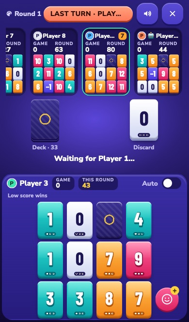 |            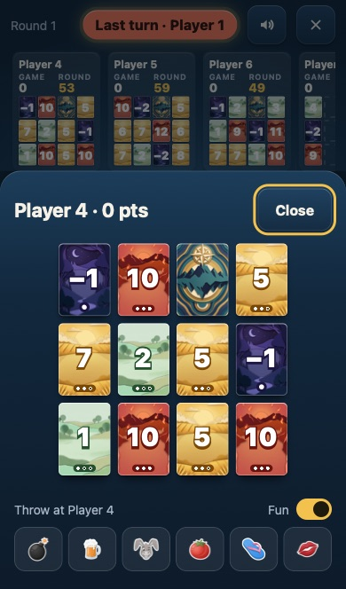            |                             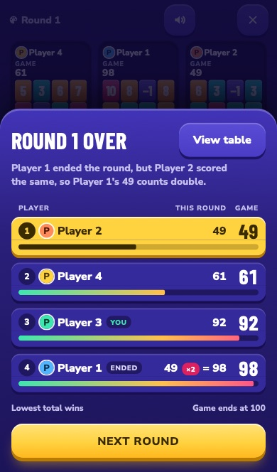                             |
|                                                                                    **Play until one is left: out at 100**                                                                                    |                                                                                                              **Out · watching**                                                                                                              |                                                                                                                                   **The last one left wins**                                                                                                                                    |
|                                      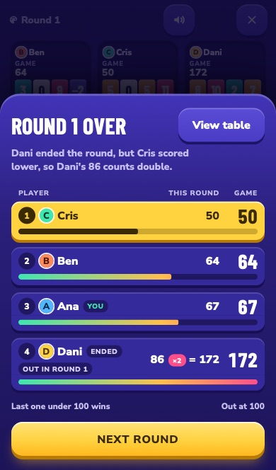                                      |                       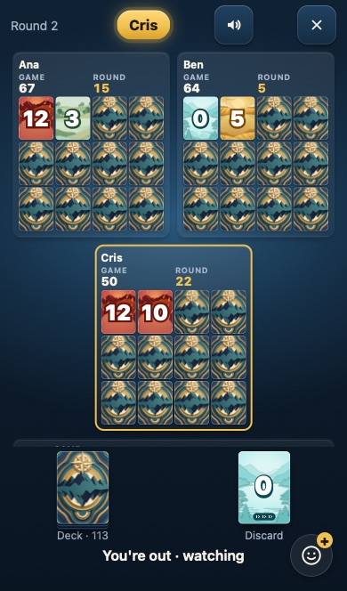                        |                                                                      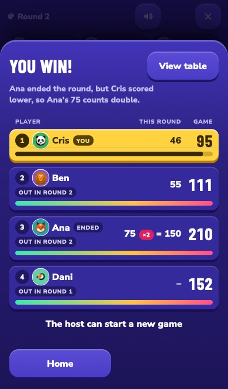                                                                      |
|                                                                                   **Chat: quick phrases, emojis, or type**                                                                                   |                                                                                                    **Learn to play: a one-minute lesson**                                                                                                    |                                                                                                                                                                                                                                                                                                 |
|      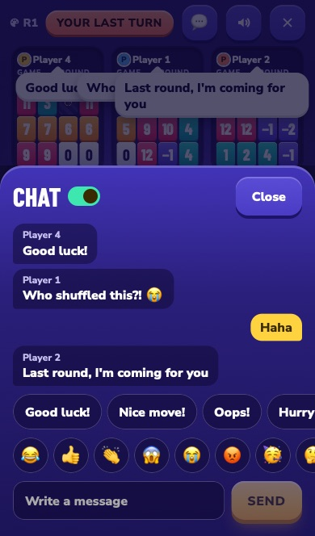      |       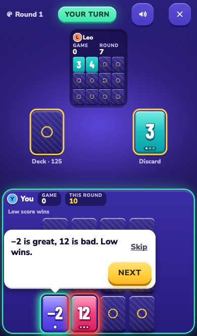       |                                                                                                                                                                                                                                                                                                 |

The images come from the real app (`npm run shots:readme`) and are refreshed whenever the UI changes. See [`docs/PLAN.md`](docs/PLAN.md) for the roadmap and how it was built.

## Play

- **Learn to play:** new to the game? The first time you open it, Home offers a one-minute lesson (and **Learn to play** starts it again any time). You play one short round against Leo on the real table. A speech bubble says one thing at a time and points at what to tap: flip two cards, why low cards are good, take from the discard pile, throw a high card away and flip, clear a column of three, and end the round, where the scores explain the doubling. **Skip** leaves at any step. It needs no room, no name and no connection.
- **Online with friends:** tap **Create a room**, then **Invite friends** to share the link (or read out the 5-letter code). Everyone enters a name and joins. The host taps **Start game**. If you reload or lose signal, you get your seat back automatically. A ninth person, or anyone arriving mid-game, watches until the game ends: every grid, two to a row, scrolled to whoever is playing, with the deck, the discard pile and the drawn card always in view. A room holds 20 connected phones, players included, and players always get back in.
- **Public rooms:** to play with whoever is around, tap a room under **Public rooms** on the home screen: each shows its host, the seats taken out of 8, and whether it plays until one is left. To open yours to strangers, switch on **Public room** in the lobby (only the host can; everyone sees it). The room is listed while it waits in the lobby with a free seat and someone seated is there, and comes off the list when the game starts. Rooms are private unless the host switches it on. Each network can list 2 public rooms at a time. In a public lobby the host can remove anyone with ✕ by their name; they go back to the home screen and can't rejoin that room for 10 minutes.
- **At the table:** swipe the strip of opponents to see every grid; tap one to see it full size. Whoever is playing scrolls into view. The speaker in the header mutes sounds (remembered; an iPhone on silent stays silent). A card you tap lifts at once and stays up until the server answers. "Reconnecting…" at the top means your phone is offline or the server is slow to answer.
- **Pick your look:** **Modern** (the default: glossy cards on a purple stage) or **Classic** (paper-cut art on a night-blue table). Two small cards on Home switch between them; in a game, tap the palette by the round number. It changes at once, only on your phone, and is remembered.
- **Know where you stand:** every player's numbers have captions: **Game** is their total, and **Round** (the gold one) is their face-up cards this round, so you can see who is low before the cards are counted. Each face-up card of yours carries a weight mark under its number: a diamond below zero, then no dot, one, two or three for 0, 1–4, 5–8 and 9–12. On your turn a frame lights up around your cards, the card you drew glows between the piles, and the discard pile reads **Discard here**. The round summary gives each player a bar toward 100 and says in a sentence why the ender's score doubled. When a round starts, the players' line under the piles says who starts and why ("Ben starts: highest pair (17)"). With one face-down card left, your turn reminds you that revealing it ends the round. When someone reveals their whole grid, every phone plays a two-note chime and buzzes: everyone's next turn is their last. At game over the winner's phone buzzes longer, and going out gets a short buzz.
- **Throw things:** tap an opponent, then a bomb, a beer, a donkey, a tomato, a flip-flop or a kiss under their cards. Everyone sees it wind up, fly across the table and land with its own gag: the bomb blows up and leaves soot, the tomato splats, the beer pours foam, the flip-flop bonks, the kiss leaves lipstick, the donkey headbutts and leaves hoof prints. The phone it hits buzzes, and a bomb shakes it. One throw every 3 seconds each, while a round is being played (not from a summary's **View table**); the **Fun** switch in the same place turns them, and reactions, off on your phone.
- **React:** the round 🙂 button by your cards (beside the bottom row, or in your name bar on phones where your cards fill the width) opens four reactions: a laughing baby, a heart-eyed "aww yeah", a fuming scream through gritted teeth, and the **migajero**: a pigeon flies a card to the player who just fed the next one a good card, and a "PIGEON FEEDER!" sign with your name drops over them. Laughs, love and anger pop over your own name on every phone (once you're out of a knockout game, yours pops over the button on your own phone). One throw or reaction every 3 seconds each.
- **Chat:** 💬 in the top bar opens the chat: tap a quick phrase ("Good luck!", "Nice move!", "Oops!"…; each friend reads it in their own language) or an emoji, or type up to 80 characters. Your message pops up as a speech bubble by your name on every phone for 3 seconds, and the sheet keeps the last 30. The button counts what you haven't read. It works in the lobby, during the game and over the scores, for players and for anyone watching. Up to 3 messages in a row, then one every 3 seconds each. The **Chat** switch in the sheet turns it off on your phone.
- **Install it:** on Android, Chrome offers _Install app_. On iPhone, tap **Share → Add to Home Screen**. It then opens full-screen like an app.
- **Turn clock and Auto-play:** each turn has 30 seconds, and at least 10 to place a card you drew. A bar above your cards, beside **Low score wins**, drains; at 10 seconds it turns orange and counts down, at 5 it turns red with one buzz and one tick. When time runs out the game plays for you and switches on **Auto-play**, the switch above your cards, which keeps playing your turns until you switch it off. Switch it on yourself before stepping away. Everyone sees 🤖 by your name. **Play again** switches everyone's Auto-play off. The screen stays on during a game.
- **Seat order:** in the lobby, the host drags players up and down by the ≡ handle beside each name. Turns go down the list, so this decides who plays after whom (for example, so couples don't play right after each other). Everyone sees the order as it changes.
- **Play until one is left:** the host can switch this on in the lobby before starting (everyone sees it). After each round, everyone at 100 or more is out: they keep their seat and score and watch the rest of the game. The others play on, down to two head to head, until at most one is left under 100. Rematch puts everyone back in.
- **If a phone drops:** it gets the same 30 seconds, and everyone sees "Cris is offline · auto-play in 24 s". Then Auto-play takes over. They get their seat back as soon as they reconnect, and switch Auto-play off to play again.

## How to play

- Everyone gets 12 face-down cards in a 3 × 4 grid and flips any 2. Whoever's 2 cards add up highest starts.
- The server shuffles all 150 cards for every round with a cryptographic generator and a fresh seed. The cards on the table tell nobody what is still face down or in the deck, and streaks of equal cards are just chance: the deck is never arranged.
- On your turn, draw from the deck or take the top card of the discard pile.
  - A deck card can replace any card in your grid, or you can throw it away and flip one of your face-down cards instead. To throw it away, tap the discard pile; until you flip a card, **↶ Undo** gives it back.
  - A card from the discard pile must replace a grid card.
  - Whatever you replace goes face up onto the discard pile.
- Three equal face-up cards in a column disappear.
- Reveal your whole grid to end the round. Everyone else gets one last turn, then all cards are revealed and counted. If you ended the round without the strictly lowest score, your positive score is doubled.
- When someone reaches 100 points the game ends. Lowest total wins.
- **Play until one is left** (a lobby option): instead, after each round everyone at 100 or more is out, and the others play on. The last player under 100 wins; if everyone left reaches 100 in the same round, the lowest total among them wins. The final ranking puts the winner first, then whoever went out later, then the lower total.
- Each turn has 30 seconds (and at least 10 to place a card you drew). When time runs out, Auto-play plays for you until you switch it off. It draws from the deck, keeps a card that beats your highest face-up card, and never reveals your last face-down card while it can swap instead, unless the round is already ending or nobody at the table is playing by hand. When everyone is on Auto-play, the game plays on to the round summary, then waits for someone to tap **Next round**.

The exact rules, including how edge cases are decided, are in [`AGENTS.md` § Rules](AGENTS.md#rules).

## Run locally

Requires Node 22+.

```sh
npm install
npm run dev        # http://localhost:5173 — app + Worker + Durable Objects, all local
npm test           # unit tests
npm run e2e        # Playwright (first time: npx playwright install chromium webkit)
SERVER=node npx playwright test e2e/online.spec.ts --project=pixel   # same suite on the Node server
npm run shots:readme   # regenerate the images above (needs ffmpeg)
```

## Deploy (Cloudflare, free plan)

The app, the Worker, one Durable Object per room and one for the public-room list deploy together to Cloudflare Workers. The free plan needs no credit card. CI deploys every push to `main` after all checks pass, then plays a 2-phone round against the live URL. Each network is limited, every minute, to 30 API requests, 10 new rooms and 120 units of work: roughly one unit per storage write it causes (game messages, presence checks of rooms it keeps open, new rooms, changes to and reads of the public-room list). So one network needs at least 14 hours to use up the free plan's daily storage writes or Durable Object requests. The Worker's 100,000 requests a day are still exposed to any flood (see `CHANGELOG.md`, 2.0.3 and 2.0.4).

One-time setup:
1. Create a free Cloudflare account. In **Workers & Pages**, pick a `workers.dev` subdomain. Don't create an application; the first deploy does that.
2. Create an API token from the **Edit Cloudflare Workers** template.
3. In the GitHub repo settings, add the secrets `CLOUDFLARE_API_TOKEN` and `CLOUDFLARE_ACCOUNT_ID`. Stricter option: add them as secrets of the `production` environment, and limit that environment's deployment branches to `main`. The deploy job already uses that environment, so only `main` can then read them.

The free plan has no usage alerts, so the `Health` workflow loads the live page and creates a room every hour. When a daily quota runs out it fails, its error says which quota, and GitHub emails whoever last edited its `cron` line or last re-enabled it (keep Actions emails on in your GitHub notification settings). Expect one email an hour until the quotas reset at 00:00 UTC. It costs 24 Worker requests, 48 Durable Object requests and 72 storage writes a day. GitHub disables scheduled workflows in a public repository after 60 days without activity. If that happens, re-enable it: **Actions** → **Health** → **Enable workflow**.

If a deploy misbehaves, run `npx wrangler rollback` to return to the previous version. The game is then live at `https://skyjo-online.<your-subdomain>.workers.dev`. To redeploy by hand, run the CI workflow on `main` from the Actions tab. From your own machine, run `npx wrangler login`, then `npm run build && npx wrangler deploy`.

## Self-host (fallback)

The same rooms also run on plain Node with `ws`, held in memory, so a restart ends every game in progress:

```sh
npm run build && npm run build:node
npm start                      # http://127.0.0.1:8787 (PORT=… to change)
```

To let friends reach it without opening router ports, run a [Cloudflare quick tunnel](https://developers.cloudflare.com/cloudflare-one/connections/connect-networks/do-more-with-tunnels/trycloudflare/) and share the `https://….trycloudflare.com` URL it prints:

```sh
cloudflared tunnel --url http://127.0.0.1:8787
```

The server only listens on `127.0.0.1`, so nothing but the tunnel can reach it. `HOST=0.0.0.0 npm start` would open it to your whole network; do that only if you mean to. The tunnel exposes the game to the internet for as long as it runs, so stop it (Ctrl-C) when the game ends.

## Contributing

Read [`AGENTS.md`](AGENTS.md) for architecture, commands, conventions, and the PR workflow. Every PR bumps the version in `package.json` and adds a section for it to [`CHANGELOG.md`](CHANGELOG.md). When that version reaches `main` and the live smoke test passes, CI tags it and publishes a [GitHub Release](https://github.com/jack1590/skyjo-online/releases) with those notes.

## Credits

Sound effects: [Kenney](https://kenney.nl) "Casino Audio", "Interface Sounds" and "Music Jingles" (CC0); the clock's tick and the last-round chime are generated for this project. Throw sounds: [freesound.org](https://freesound.org) recordings by meisterleise, Seidolon, modusmogulus, TheWah, minian89, TheKingOfGeeks360, nebulasnails, p1xol, magnuswaker and Breviceps (all CC0), edited for this project. Reaction sounds: freesound.org recordings by amccoy711, NaBoKaMe, Reitanna, haulaway and Kinoton (all CC0), edited for this project. Card art, throw stickers, reaction stickers and app icon are original, generated for this project. Fonts of the Modern look: [Barlow Condensed](https://github.com/jpt/barlow) Bold, © 2017 The Barlow Project Authors, and [Nunito Sans](https://github.com/Fonthausen/NunitoSans) ExtraBold, © 2016 The Nunito Sans Project Authors, both under the [SIL Open Font License 1.1](https://openfontlicense.org) (the licence texts are in `public/fonts/`), unmodified subsets as served by Google Fonts.

## License

[MIT](LICENSE). Card art and text are original to this project.
