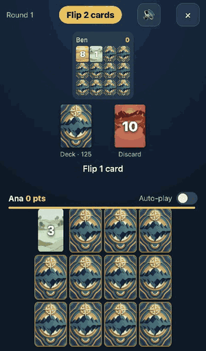
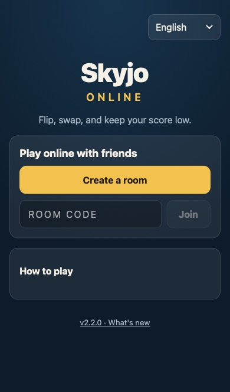
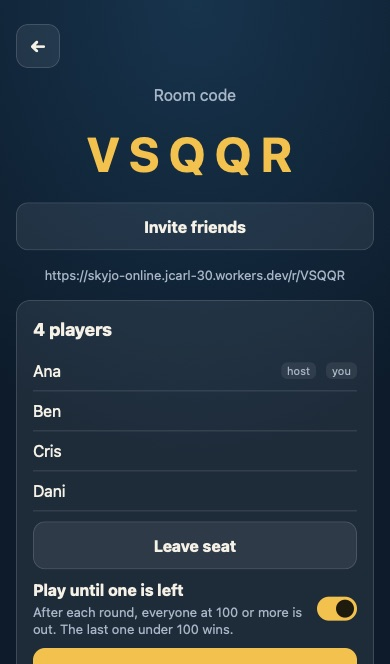
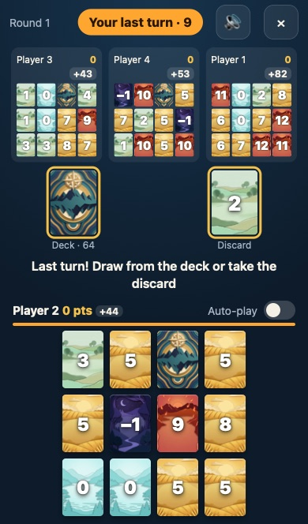
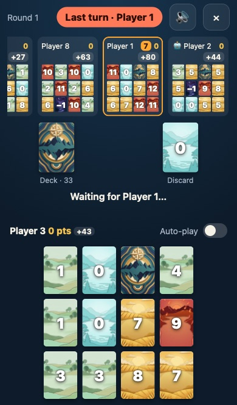
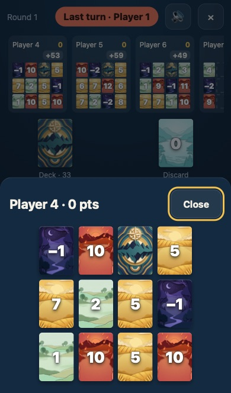
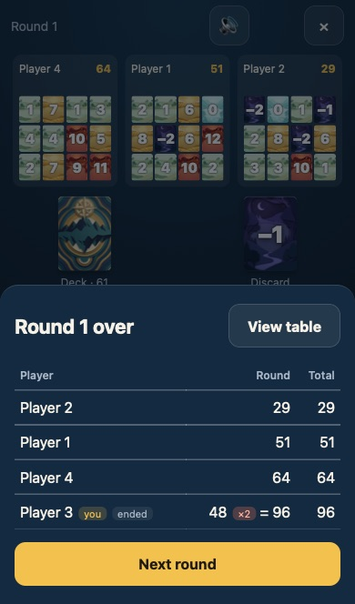
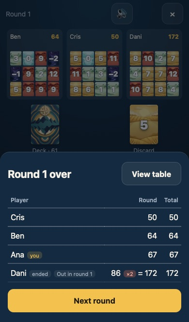
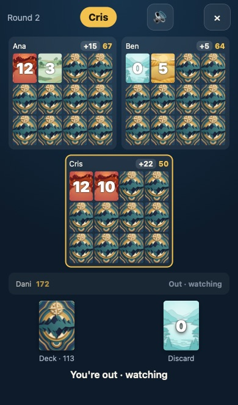
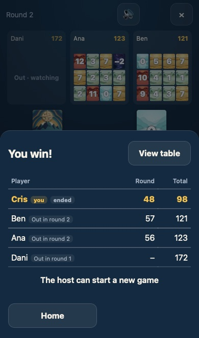

# Skyjo Online

A free, phone-first multiplayer card game based on Skyjo's mechanics. Open a link, pick a name, and play with 2–8 friends in real time. No accounts. Available in English, Spanish (Latin America), and Portuguese (Brazil).

**Play now: https://skyjo-online.jcarl-30.workers.dev** · [What's new](CHANGELOG.md) · [Releases](https://github.com/jack1590/skyjo-online/releases)

<p align="center">
  
</p>

|                                                                                             Start or join a room                                                                                             |                                                                                         Invite friends                                                                                          |                                                                                                         Your turn, 9 seconds left                                                                                                          |
| :----------------------------------------------------------------------------------------------------------------------------------------------------------------------------------------------------------: | :---------------------------------------------------------------------------------------------------------------------------------------------------------------------------------------------: | :----------------------------------------------------------------------------------------------------------------------------------------------------------------------------------------------------------------------------------------: |
|                                                                                                            |                                            |  |
|                                                                                       **8 players, one on Auto-play**                                                                                        |                                                                                       **Tap an opponent**                                                                                       |                                                                                                             **Round summary**                                                                                                              |
|  |                                                                                                           |                                                                |
|                                                                                    **Play until one is left: out at 100**                                                                                    |                                                                                       **Out · watching**                                                                                        |                                                                                                         **The last one left wins**                                                                                                         |
|                                                                            |  |                                                                                       |

The images come from the real app (`npm run shots:readme`) and are refreshed whenever the UI changes. See [`docs/PLAN.md`](docs/PLAN.md) for the roadmap and how it was built.

## Play

- **Online with friends:** tap **Create a room**, then **Invite friends** to share the link (or read out the 5-letter code). Everyone enters a name and joins. The host taps **Start game**. If you reload or lose signal, you get your seat back automatically. A ninth person, or anyone arriving mid-game, watches until the game ends: every grid, two to a row, scrolled to whoever is playing, with the deck, the discard pile and the drawn card always in view. A room holds 20 connected phones, players included, and players always get back in.
- **At the table:** swipe the strip of opponents to see every grid; tap one to see it full size. Whoever is playing scrolls into view. 🔊 in the header mutes sounds (remembered; an iPhone on silent stays silent). A card you tap lifts at once and stays up until the server answers. "Reconnecting…" at the top means your phone is offline or the server is slow to answer.
- **Know where you stand:** under every total, a small number such as **+14** is that player's face-up cards this round, so you can see who is low before the cards are counted. When a round starts, the line under the piles says who starts and why ("Ben starts: highest pair (17)"). With one face-down card left, your turn reminds you that revealing it ends the round. When someone reveals their whole grid, every phone plays a two-note chime and buzzes: everyone's next turn is their last. At game over the winner's phone buzzes longer, and going out gets a short buzz.
- **Install it:** on Android, Chrome offers _Install app_. On iPhone, tap **Share → Add to Home Screen**. It then opens full-screen like an app.
- **Turn clock and Auto-play:** each turn has 30 seconds, and at least 10 to place a card you drew. A bar above your cards drains; at 10 seconds it turns orange and counts down, at 5 it turns red with one buzz and one tick. When time runs out the game plays for you and switches on **Auto-play**, the switch above your cards, which keeps playing your turns until you switch it off. Switch it on yourself before stepping away. Everyone sees 🤖 by your name. The screen stays on during a game.
- **Play until one is left:** the host can switch this on in the lobby before starting (everyone sees it). After each round, everyone at 100 or more is out: they keep their seat and score and watch the rest of the game. The others play on, down to two head to head, until at most one is left under 100. Rematch puts everyone back in.
- **If a phone drops:** it gets the same 30 seconds, and everyone sees "Cris is offline · auto-play in 24 s". Then Auto-play takes over. They get their seat back as soon as they reconnect, and switch Auto-play off to play again.

## How to play

- Everyone gets 12 face-down cards in a 3 × 4 grid and flips any 2. Whoever's 2 cards add up highest starts.
- On your turn, draw from the deck or take the top card of the discard pile.
  - A deck card can replace any card in your grid, or you can throw it away and flip one of your face-down cards instead. To throw it away, tap the discard pile; until you flip a card, **↶ Undo** gives it back.
  - A card from the discard pile must replace a grid card.
  - Whatever you replace goes face up onto the discard pile.
- Three equal face-up cards in a column disappear.
- Reveal your whole grid to end the round. Everyone else gets one last turn, then all cards are revealed and counted. If you ended the round without the strictly lowest score, your positive score is doubled.
- When someone reaches 100 points the game ends. Lowest total wins.
- **Play until one is left** (a lobby option): instead, after each round everyone at 100 or more is out, and the others play on. The last player under 100 wins; if everyone left reaches 100 in the same round, the lowest total among them wins. The final ranking puts the winner first, then whoever went out later, then the lower total.
- Each turn has 30 seconds (and at least 10 to place a card you drew). When time runs out, Auto-play plays for you until you switch it off. It draws from the deck, keeps a card that beats your highest face-up card, and never reveals your last face-down card while it can swap instead, unless the round is already ending or nobody at the table is playing by hand. When everyone is on Auto-play, the game plays on to the round summary, then waits for someone to tap **Next round**.

The exact rules, including how edge cases are decided, are in [`AGENTS.md` § Rules](AGENTS.md#rules).

## Run locally

Requires Node 22+.

```sh
npm install
npm run dev        # http://localhost:5173 — app + Worker + Durable Objects, all local
npm test           # unit tests
npm run e2e        # Playwright (first time: npx playwright install chromium webkit)
SERVER=node npx playwright test e2e/online.spec.ts --project=pixel   # same suite on the Node server
npm run shots:readme   # regenerate the images above (needs ffmpeg)
```

## Deploy (Cloudflare, free plan)

The app, the Worker and one Durable Object per room deploy together to Cloudflare Workers. The free plan needs no credit card. CI deploys every push to `main` after all checks pass, then plays a 2-phone round against the live URL. Each network is limited, every minute, to 30 API requests, 10 new rooms and 120 units of work: roughly one unit per storage write it causes (game messages, presence checks of rooms it keeps open, new rooms). So one network needs at least 14 hours to use up the free plan's daily storage writes or Durable Object requests. The Worker's 100,000 requests a day are still exposed to any flood (see `CHANGELOG.md`, 2.0.3 and 2.0.4).

One-time setup:
1. Create a free Cloudflare account. In **Workers & Pages**, pick a `workers.dev` subdomain. Don't create an application; the first deploy does that.
2. Create an API token from the **Edit Cloudflare Workers** template.
3. In the GitHub repo settings, add the secrets `CLOUDFLARE_API_TOKEN` and `CLOUDFLARE_ACCOUNT_ID`. Stricter option: add them as secrets of the `production` environment, and limit that environment's deployment branches to `main`. The deploy job already uses that environment, so only `main` can then read them.

The free plan has no usage alerts, so the `Health` workflow loads the live page and creates a room every hour. When a daily quota runs out it fails, its error says which quota, and GitHub emails whoever last edited its `cron` line or last re-enabled it (keep Actions emails on in your GitHub notification settings). Expect one email an hour until the quotas reset at 00:00 UTC. It costs 24 Worker requests, 48 Durable Object requests and 72 storage writes a day. GitHub disables scheduled workflows in a public repository after 60 days without activity. If that happens, re-enable it: **Actions** → **Health** → **Enable workflow**.

If a deploy misbehaves, run `npx wrangler rollback` to return to the previous version. The game is then live at `https://skyjo-online.<your-subdomain>.workers.dev`. To redeploy by hand, run the CI workflow on `main` from the Actions tab. From your own machine, run `npx wrangler login`, then `npm run build && npx wrangler deploy`.

## Self-host (fallback)

The same rooms also run on plain Node with `ws`, held in memory, so a restart ends every game in progress:

```sh
npm run build && npm run build:node
npm start                      # http://127.0.0.1:8787 (PORT=… to change)
```

To let friends reach it without opening router ports, run a [Cloudflare quick tunnel](https://developers.cloudflare.com/cloudflare-one/connections/connect-networks/do-more-with-tunnels/trycloudflare/) and share the `https://….trycloudflare.com` URL it prints:

```sh
cloudflared tunnel --url http://127.0.0.1:8787
```

The server only listens on `127.0.0.1`, so nothing but the tunnel can reach it. `HOST=0.0.0.0 npm start` would open it to your whole network; do that only if you mean to. The tunnel exposes the game to the internet for as long as it runs, so stop it (Ctrl-C) when the game ends.

## Contributing

Read [`AGENTS.md`](AGENTS.md) for architecture, commands, conventions, and the PR workflow. Every PR bumps the version in `package.json` and adds a section for it to [`CHANGELOG.md`](CHANGELOG.md). When that version reaches `main` and the live smoke test passes, CI tags it and publishes a [GitHub Release](https://github.com/jack1590/skyjo-online/releases) with those notes.

## Credits

Sound effects: [Kenney](https://kenney.nl) "Casino Audio", "Interface Sounds" and "Music Jingles" (CC0); the clock's tick and the last-round chime are generated for this project. Card art and app icon are original, generated for this project.

## License

[MIT](LICENSE). Card art and text are original to this project.
